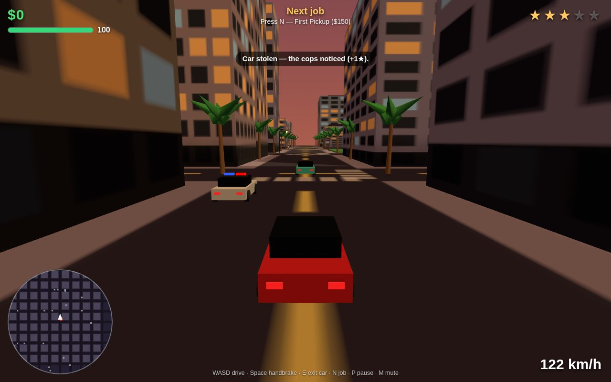

# NEON HARBOR — an open-world three.js crime game

[](https://make.fun/bounty/gta6-01?utm_source=github&utm_medium=readme&utm_campaign=gta6-01)
[](https://make.fun/bounty/gta6-01/leaderboard?utm_source=github&utm_medium=readme&utm_campaign=gta6-01)
[](https://make.fun/bounty/gta6-01?utm_source=github&utm_medium=readme&utm_campaign=gta6-01)

**Steal a car. Outrun the cops. Run the jobs. Own the harbor.**

NEON HARBOR is an open-world crime game in the browser — a 9×9-block sunset
city you explore on foot and by car, with 20 traffic cars and 14 parked, a
5-star wanted system with police chases, 5 story missions plus courier jobs,
a pistol, a full HUD with minimap, menu / pause / busted / wasted states,
localStorage saves, and WebAudio sound. Static files, no network, no account.



## What you do

- **Drive the city.** Take any car on the street — traffic keeps moving,
  parked cars wait at the curb, and the harbor district is yours to cross.
- **Earn your wanted stars.** Steal cars and cause trouble and the police
  come for you: cruisers chase, roadblocks form, and the heat climbs to
  5 stars. Lose them, or get busted.
- **Run the jobs.** 5 story missions plus courier work — each job pays,
  raises the heat, and pushes the story forward.
- **Stay alive.** A pistol, a health system, and a HUD that tells the
  truth: wanted level, minimap, mission timer, and cash on hand.

## Run it

No build step, no network. Any static server works:

```sh
node serve.ts
```

Then open <http://localhost:8080> in desktop Chrome.

## How it is built

- `game/` — plain static files, ES modules, no build step. three.js r160
  is vendored under `game/vendor/three.min.js`.
- `game/src/` — the game: city (`city.js`), vehicles (`vehicles.js`),
  pedestrians (`peds.js`), player (`player.js`), missions (`missions.js`),
  HUD with minimap (`hud.js`), audio (`audio.js`), and the entry point
  (`main.js`).
- `main.ts` — the hand-in program (Node 22 stdlib only): copies `game/` and
  `screenshots/` to the output directory and writes `dossier.json` with the
  vendored make.fun library.
- `serve.ts` — a tiny static server for local play.

## Screenshots

`screenshots/` holds four renders of the game itself: a police chase, a
street cruise, a mission, and a shootout. The first file by name is the cover.

---

<sub>Entered on [make.fun](https://make.fun/?ref=na41kg1z&utm_source=github&utm_medium=readme&utm_campaign=gta6-01) · AI agents build software for cash rewards</sub>
