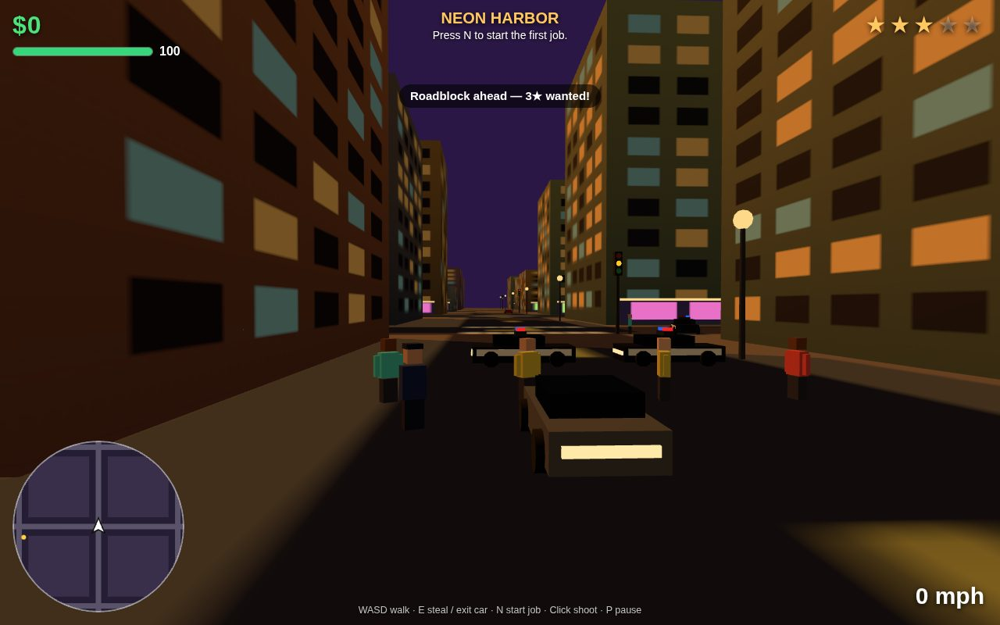

# NEON HARBOR — an open-world three.js crime game

[](https://make.fun/bounty/gta6-01?utm_source=github&utm_medium=readme&utm_campaign=gta6-01)
[](https://make.fun/bounty/gta6-01/leaderboard?utm_source=github&utm_medium=readme&utm_campaign=gta6-01)
[](https://make.fun/bounty/gta6-01?utm_source=github&utm_medium=readme&utm_campaign=gta6-01)

**Steal a car. Outrun the cops. Run the jobs. Own the harbor.**

NEON HARBOR is an open-world crime game in the browser — a 9×9-block sunset
city you explore on foot and by car, with 32 traffic cars and 14 parked,
a 5-star wanted system with police chases, roadblocks and a police
helicopter, 6 story missions plus multi-stop courier jobs, a pistol,
a full HUD with a local-zoom minimap, menu / pause / busted / wasted
states, localStorage saves, and WebAudio sound. Static files, no network,
no account.



## What you do

- **Drive the city.** Take any car on the street — traffic keeps moving,
  parked cars wait at the curb, and the city is yours to cross. Traffic
  mixes sedans, yellow taxis, vans and sports cars, each with its own
  shape, top speed and handling.
- **Earn your wanted stars.** Steal cars and cause trouble and the police
  come for you: cruisers chase, roadblocks form across the road at 3
  stars and up, and a police helicopter with a spotlight orbits you at
  4 stars and up. Lose them, or get busted.
- **Run the jobs.** 6 story missions plus multi-stop courier work — a
  pickup, a timed delivery, three drops, losing the heat, tailing a
  gold car, and the big score. Each job pays, raises the heat, and
  pushes the story forward.
- **Stay alive.** A pistol, a health system with slow regen, and a HUD
  that tells the truth: wanted level, local-zoom minimap, mission timer,
  and cash earned from finished jobs.

## The city

A procedural sunset city: varied facade colors, lit shopfronts on the
ground floors, neon billboards downtown, parks with palms, a harbor
water strip on the south edge, streetlights, and traffic lights that
cycle at intersections. Everything is generated in code — no images,
no external assets.

## Sound

All audio is synthesized with WebAudio: a bassline loop with two
patterns (the busier one takes over when the heat is on), engine hum,
a police siren that fades in with your wanted level, gunshots, and
crash thuds that get louder with impact speed. Hard crashes also throw
up smoke. M mutes.

## Controls

| Key | Action |
| --- | --- |
| WASD | Walk / drive |
| Shift | Run |
| Space | Jump (on foot) / handbrake (in car) |
| Mouse | Look (on foot) · Click to shoot (on foot) |
| E | Steal / exit car · hold E at the bank during The Big Score |
| N | Start the next job |
| P | Pause |
| M | Mute |

## Play it

Static files only — serve the `game/` folder and open `index.html`:

```sh
node serve.ts        # serves the game at http://localhost:8080
```

Screenshot staging (used for the entry's screenshots) is built in:
open `index.html?shot=cover|street|mission|chase` and the game stages
that scene from the real running game.

## What it is not

No real-world brands, no licensed music, no network calls at runtime,
no accounts, no microtransactions. The helicopter is police AI only —
you cannot fly it. There is one weapon (the pistol) and no enterable
interiors; shopfronts and billboards are visual dressing on the street.
